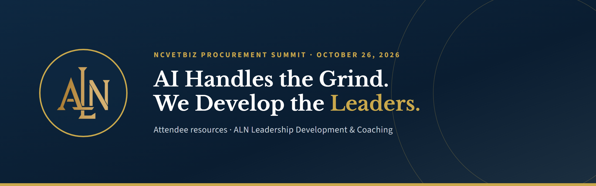
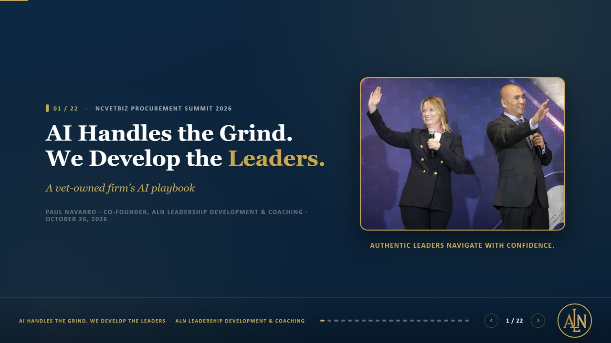
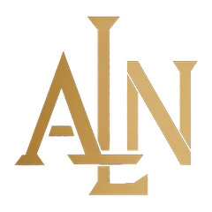

  

  <strong>Attendee resources from the NCVetBiz Procurement Summit</strong> 
  McKimmon Center, Raleigh, NC &middot; October 26, 2026

  
  
  

---

## Thank you for joining us

Small firms cannot afford a back office, so the owner becomes the back office. This session showed how a two-person, service-disabled veteran-owned firm uses AI to carry the grind (solicitations, client prep, event research) so the owners can spend their time on the work that matters: developing leaders.

Everything here is free to use. **No code is required** for any of the prompts.

  

## What is in this repo

| Resource | What it is | Format |
|---|---|---|
| [Slides](slides/AI-Handles-the-Grind.pdf) | The full presentation, 22 slides | PDF |
| [Try This Monday handout](handout/Try-This-Monday.pdf) | Four prompts, six guardrails, and a worksheet on two printable pages | PDF, [HTML](handout/Try-This-Monday.html) |
| [Prompts](prompts/) | Each prompt as its own page with a one-click copy box | Markdown |
| [Guardrails](prompts/guardrails.md) | Six rules for using AI safely in a small business | Markdown |
| [Ideal client worksheet](prompts/ideal-client-worksheet.md) | The four lines that make every other prompt better | Markdown |

## The four prompts

Copy a prompt into the AI tool you already have (ChatGPT, Claude, Gemini, or Microsoft Copilot), replace the `[brackets]`, and paste your material at the end. **Start with one prompt this week.** Read every answer before you use it.

| # | Prompt | Use it when |
|:-:|---|---|
| 1 | [Bid / No-Bid Memo](prompts/01-bid-no-bid-memo.md) | A public solicitation lands and you need to decide fast whether it is worth your time. |
| 2 | [Event Scorer](prompts/02-event-scorer.md) | There are more networking events than Saturdays. |
| 3 | [Follow-Up Drafter](prompts/03-follow-up-drafter.md) | You just left a meeting and want the follow-up out while it is fresh. |
| 4 | [Write the Process Down](prompts/04-write-the-process-down.md) | You repeat a task every week. This is how a prompt becomes a system. |

## The rule under everything

<table>
  <tr>
    <td align="center" width="33%"><h3>AI drafts</h3>Fast first versions of the work nobody wants to start.</td>
    <td align="center" width="33%"><h3>The owner approves</h3>Judgment stays human. Anything that leaves the building gets a person's eyes first.</td>
    <td align="center" width="33%"><h3>Approved work stays locked</h3>Once you sign off, the system is not allowed to change it.</td>
  </tr>
</table>

## Six guardrails

1. **Protect client data.** Use a business plan with data protections, or strip names and personal details before you paste.
2. **Make it show its sources.** Ask what it based the answer on, and what it does not know.
3. **A human sends it.** Anything that leaves your business gets a person's eyes first.
4. **Never let it invent credentials.** Past performance, certifications, and prices come from you, not the model.
5. **Get a second opinion.** Check important work with a second AI from a different company.
6. **Start with one annoying task.** Not a strategy. One task. Then the next one.

Full text: [prompts/guardrails.md](prompts/guardrails.md)

## A note on privacy

The demo videos shown in the session are not published here. The slides PDF replaces each video with a short description, and the dashboard screenshot uses made-up client names. No client information is included anywhere in this repository.

## About ALN

**ALN Leadership Development & Coaching** is a service-disabled veteran-owned small business in North Carolina. We help leaders lead themselves, their people, and their organizations, using Positive Psychology, Positive Intelligence, Maxwell Leadership, and DISC.

*Built on Service. Driven by Science.*

 

| | |
|---|---|
| **Presenter** | Paul Navarro, Co-Founder, Maxwell Certified Trainer & DISC Consultant |
| **Email** | [paul.navarro@alnleadership.com](mailto:paul.navarro@alnleadership.com) |
| **Phone** | 919-213-1502 |
| **Web** | [alnleadership.com](https://www.alnleadership.com) |

---

Prompts and handout content are shared under the [MIT License](LICENSE). Use them, adapt them, and share them with your team.
